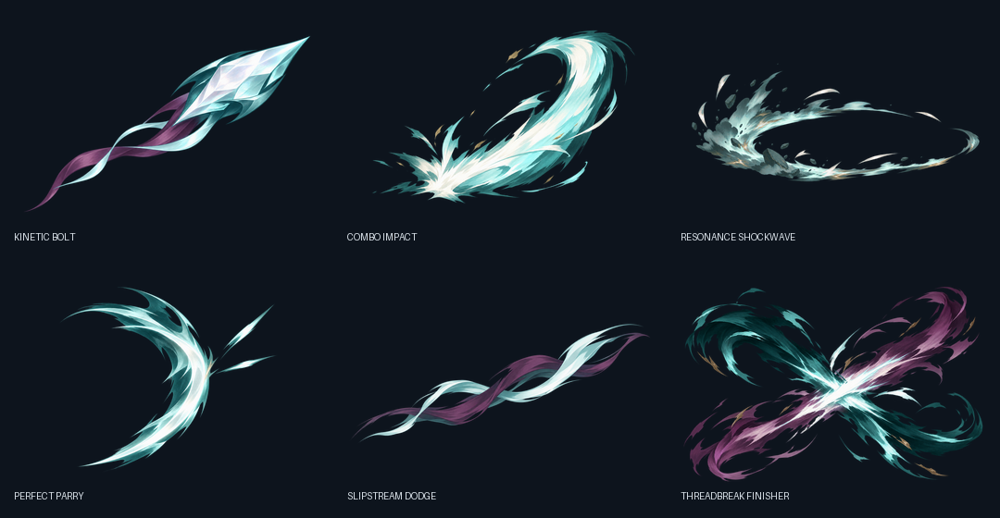
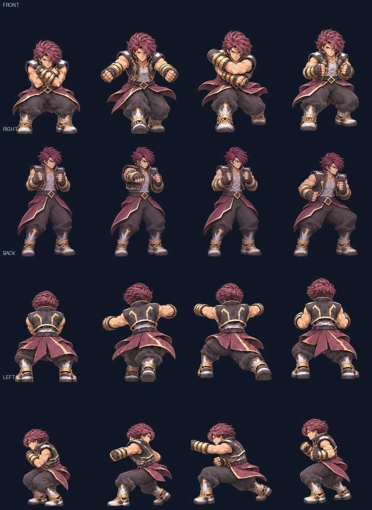
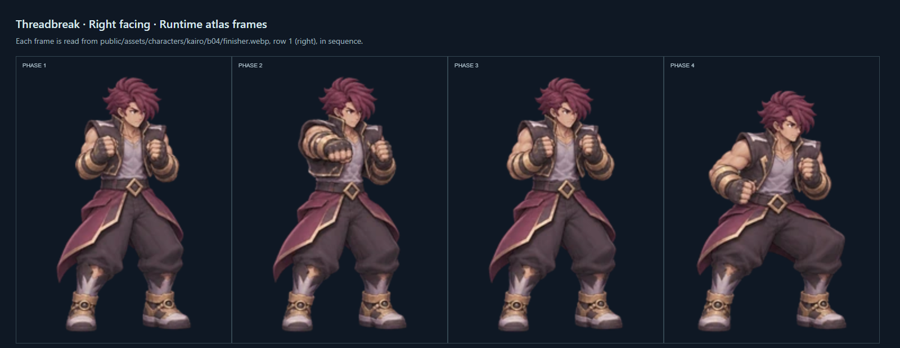

# B04 ability visual bible — Kairo base kit

**Status:** Generated art and runtime integration proposal. Owner approval is pending. All six abilities use the same original Kairo palette and outfit language; each uses its own pose timing and authored effect source. This document does not certify final production quality.

## Review boards

The character contact sheets show the runtime frame order, four directional rows and transparent-frame trimming. The VFX board shows the individual painted source effects at review scale.

Other runtime boards: [combo](../../tests/evidence/b04/contact-sheets/combo.png), [hit two](../../tests/evidence/b04/contact-sheets/combo-hit-two.png), [hit three](../../tests/evidence/b04/contact-sheets/combo-hit-three.png), [locomotion transitions](../../tests/evidence/b04/contact-sheets/locomotion-transitions.png), [bolt cast](../../tests/evidence/b04/contact-sheets/bolt-cast.png), [shockwave](../../tests/evidence/b04/contact-sheets/shockwave.png), and [guard/parry](../../tests/evidence/b04/contact-sheets/guard-parry.png).

## Pose → effect → runtime composition → game-size evidence

| Ability | Key pose and motion source | Authored effect layer | Runtime composition | Game-size screenshot / normal-speed clip |
|---|---|---|---|---|
| Kinetic String | Separate hit-one, hit-two and hit-three directional atlases; 4 phases per hit | Painted combo impact asset plus event-timed trails and hitstop | Canvas renderer combines contact pose, hit event and effect source | NOT CAPTURED in visible Chrome; owner review required |
| Kinetic Bolt | Four-direction cast sequence | Painted bolt flight and impact source images | Cast event, projectile trail, hit/dissipate events | NOT CAPTURED in visible Chrome; owner review required |
| Resonance Shockwave | Four-direction charge/release/recovery sequence | Painted radial shockwave with ground ripple | Charge, radial hit event and ring expansion are separate timed layers | NOT CAPTURED in visible Chrome; owner review required |
| Counterguard / Perfect Parry | Directional guard/parry frames | Painted deflection flare; block and parry use distinct events | Parry window drives the sharp effect and Pulse reward | NOT CAPTURED in visible Chrome; owner review required |
| Slipstream Dodge | Reuses the B03 four-direction dodge atlas | Painted slipstream afterimage/landing source | Dash start/land events drive the effect timing | NOT CAPTURED in visible Chrome; owner review required |
| Threadbreak | Four-direction four-phase sequence; right row uses the corrected four-pose strip | Painted finisher build/impact/fade source | Pulse cost, advance, hit and fade run through discrete combat events | NOT CAPTURED in visible Chrome; owner review required |

The first two columns are represented by authored source art and contact sheets. Runtime integration is present in code, but no screenshot or normal-speed recording of the combined effects in the live game was available in this environment. The missing evidence is a signoff blocker, not an implied pass.

## Character motion and crop rules

- Source masters live in `art-source/b04/`; runtime RGBA WebP atlases live in `public/assets/characters/kairo/b04/` and generated VFX exports live in `public/assets/vfx/b04/`.
- `tools/build-b04-art.py` splits the authored source grids into 192×256 cells, keeps a shared bottom-center foot pivot, uses fixed per-direction scaling and writes runtime contact sheets plus `docs/art/b04-asset-manifest.json`.
- Alpha values 1–32 are cleared. Disconnected components below 12% of the largest cell component are removed and recorded with bounds. Larger components remain for visual review. This process cannot repair a limb already clipped inside a generated source cell.
- The source grid columns are `front`, `right`, `back`, `left`; rows are action phases. Runtime sheets store phases horizontally and cardinal directions vertically.
- Threadbreak's right-facing sequence was regenerated from the owner's annotated screenshot after a head-direction correction. The builder routes this strip to the right row and removes the yellow markup from the source. The other three facing rows remain sourced from the four-direction master.
- The renderer quantizes attack aim to the dominant cardinal direction. Diagonal attacks do not have separately authored diagonal poses; diagonal visual/impact agreement still needs live review.

## VFX direction

The painted VFX share pale cyan energy cores, warm bronze edge light and muted plum shadow tones. Bolt is a narrow forward stream; combo impact is a brief directional burst; shockwave is low and radial; parry is a sharp compact deflection; dodge is a thin moving wake; Threadbreak has a broader crossing impact. Canvas timing, movement, opacity and scale complement these generated textures. The rejected hand-coded vector atlas is not loaded by the game.

## HUD art notes

The current HUD uses cropped generated animation frames as compact action previews and applies its own ready, cooldown, pulse-cost and unavailable treatments. It does not yet include a dedicated set of standalone ability glyphs. Their legibility at actual gameplay size has not been checked in visible Chrome, so the icon gate remains partial.

## Source provenance and limits

The sources were generated with OpenAI built-in ImageGen on 2026-11-06; the model/version was not exposed. The latest Threadbreak correction prompt and source reference are recorded in `docs/art/b04-asset-manifest.json`. Earlier prompt transcripts are unavailable and are not reconstructed as exact quotes. No external likeness/name/legal review has been performed, and no generated asset is approved by this document.
